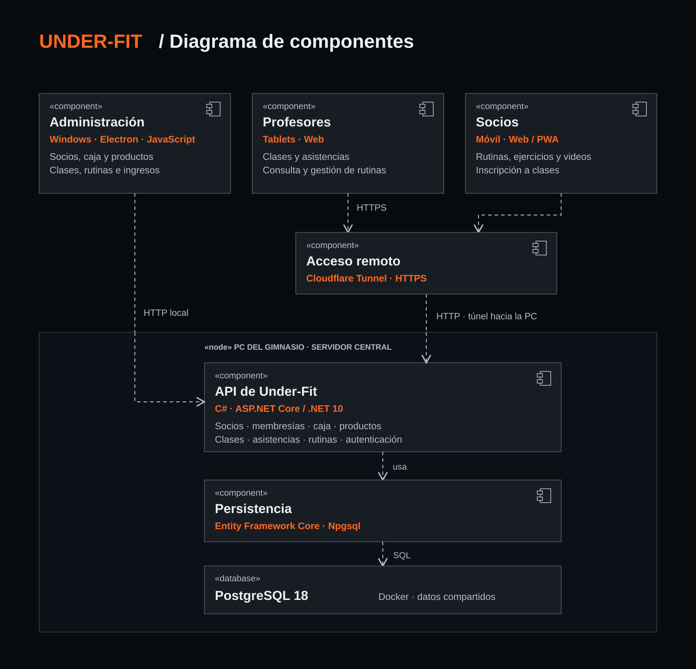

# Under-Fit

**Gestión de gimnasio en producción: escritorio Windows, tablets y una API compartida.**

Desarrollado a medida por **Amir Sholi** para un gimnasio de Uruguay con **dos locales y una caja centralizada**. Reúne socios, membresías, ingresos, ventas, clases y rutinas en una misma operación.

*Custom gym management software for a real business in Uruguay. Evolved from an Electron/SQLite desktop application into a shared .NET/PostgreSQL platform for Windows and instructor tablets.*

[](https://github.com/Amirsholi/underfit-desktop-app/actions/workflows/ci.yml)
[](https://github.com/Amirsholi/underfit-desktop-app/releases/latest)

[Historia y decisiones](docs/CASE_STUDY.md) · [Arquitectura](docs/ARCHITECTURE.md) · [Desarrollo y pruebas](docs/DEVELOPMENT.md) · [Versiones](CHANGELOG.md)

## El producto

| Área | Operación |
|---|---|
| Recepción | Validación de membresías, ingresos y pad USB independiente del teclado administrativo |
| Administración | Socios, inscripciones, renovaciones y vencimientos |
| Caja | Aperturas, cierres, efectivo, transferencias, correcciones y reportes PDF |
| Productos | Ventas, stock y disponibilidad por local |
| Entrenamiento | Clases recurrentes, inscripciones, asistencias, videos y rutinas |
| Tablets | Herramientas de profesores conectadas a los datos de administración |

**Estado al 24 de octubre de 2026:** la versión publicada más reciente es **2.5.6**. El escritorio y las tablets están en uso en el gimnasio, según la validación del responsable del proyecto. Publicación e instalación de una versión son registros distintos.

La experiencia de socios en teléfonos cuenta con una base web/PWA y endpoints de autenticación, rutinas e inscripción a clases. **La entrega móvil completa sigue pendiente de validación.** El diagrama incluye ese componente para mostrar el alcance de la arquitectura.

## Arquitectura



| Capa | Tecnologías |
|---|---|
| Escritorio e interfaces | Electron 25, JavaScript, HTML y CSS |
| API y reglas | C# 14, ASP.NET Core / .NET 10 |
| Persistencia compartida | Entity Framework Core, Npgsql, PostgreSQL 18 |
| Sistema anterior y migración | SQLite |
| Infraestructura | Docker Compose, Cloudflare Tunnel |
| Distribución | electron-builder / NSIS, electron-updater, GitHub Releases |
| Validación | Node.js test runner, xUnit, integración PostgreSQL y Python |

La PC del gimnasio aloja API y base de datos. El acceso remoto depende de que esté encendida y conectada. PostgreSQL se vincula a loopback; los clientes acceden mediante la API.

## Recorrido por el código

- **Reglas de negocio:** [Domain](backend/UnderFit.Domain) y [pruebas unitarias](backend/UnderFit.UnitTests).
- **Casos de uso:** [Application](backend/UnderFit.Application), separados de HTTP y de la interfaz.
- **Persistencia real:** [pruebas PostgreSQL](backend/UnderFit.IntegrationTests/PostgreSql/PostgreSqlVerticalSliceTests.cs).
- **Transición progresiva:** [createServices.js](services/createServices.js) selecciona servicios locales o adaptadores API.
- **Migración verificable:** [firstInstallation.js](services/firstInstallation.js) y [legacyMigration](services/legacyMigration).
- **Publicación trazable:** [publish-release-draft.js](scripts/publish-release-draft.js) comprueba commit, versión y hashes antes de subir el instalador.
- **Dispositivos Windows:** [usbKeypad.js](services/usbKeypad.js) y [sus pruebas](test/usbKeypad.test.js).

## Desarrollo

Requisitos: Windows para el escritorio, Node.js 22 y el SDK .NET de [global.json](global.json). PostgreSQL 18 / Docker para integración y API.

```powershell
npm ci
npm test
dotnet test backend/UnderFit.UnitTests/UnderFit.UnitTests.csproj
```

La [guía de desarrollo](docs/DEVELOPMENT.md) explica la API local, las pruebas y los módulos nativos de Node y Electron. Las pruebas unitarias no necesitan conectarse al gimnasio.

## Evolución y mantenimiento

El proyecto comenzó con programación manual en JavaScript, Electron y SQLite. Más adelante incorporé herramientas de IA al desarrollo, junto con revisión, pruebas y validación operativa. La arquitectura compartida respondió a nuevas necesidades de locales, profesores y dispositivos.

- [Caso de estudio](docs/CASE_STUDY.md)
- [Migración, respaldos y publicaciones](docs/OPERATIONS.md)
- [Contribución y ramas](CONTRIBUTING.md)
- [Historial de versiones](CHANGELOG.md)

Las releases distribuyen el instalador usado por el gimnasio; no son una demo pública. Datos de producción, credenciales y respaldos permanecen fuera del repositorio. Las pruebas automatizadas complementan la validación física del pad, la instalación y la restauración; no la sustituyen.
